🏥 QR Health System

QR-Based Digital Healthcare Management Application

📌 Project Overview

QR Health System is an Android application designed to simplify healthcare management through digital patient registration, QR code-based health record access, and clinic management.

It provides functionalities for patients, receptionists, and clinics to manage healthcare information efficiently.

🎯 Objectives

- Simplify patient registration.
- Maintain digital patient health records.
- Generate QR codes for patient information.
- Enable quick access to patient details through QR scanning.
- Reduce manual paperwork.

✨ Key Features

👨‍⚕️ Patient Management

- Patient registration.
- Patient profile management.
- Digital health information management.

📱 QR Code Management

- QR code generation.
- QR code scanning.
- Quick retrieval of patient information.

🏥 Clinic Management

- Clinic registration.
- Clinic information management.

🧑‍💼 Receptionist Management

- Receptionist registration.
- Patient registration support.
- Reception management.

👤 Profile Management

- User profile details.
- Account information management.

🛠️ Technologies Used

- Java
- XML
- Android Studio
- Android SDK
- QR Code Technology

⚙️ How to Run the Project

1. Clone the repository:

   git clone https://github.com/ejaz5a3/smart-qr-health-system.git

2. Open Android Studio.

3. Select Open Project.

4. Choose the downloaded project folder.

5. Wait for Gradle Sync.

6. Run the application using an emulator or Android device.

🔮 Future Enhancements

- Secure authentication.
- Cloud-based health records.
- Appointment scheduling.
- Medical report management.
- Emergency healthcare support.

📂 GitHub Repository

https://github.com/ejaz5a3/smart-qr-health-system

---

Project Domain: Healthcare Technology

Project Type: Android Application

Platform: Android

⭐ If you find this project useful, consider giving it a star!

## 📱 Application Screenshots

### Welcome and Launch
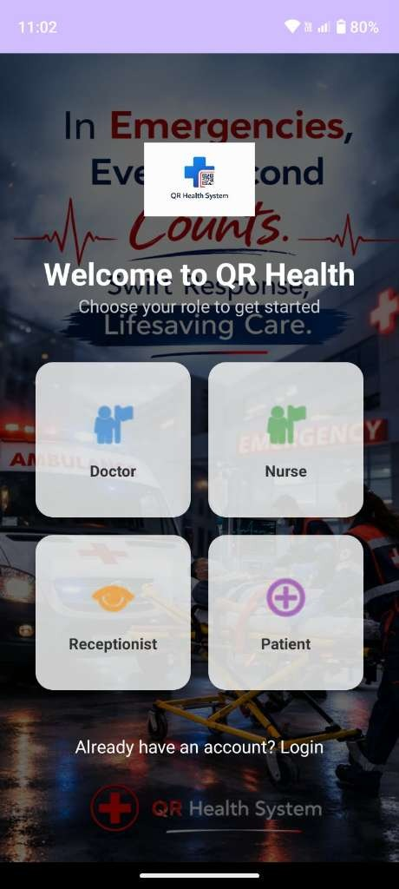
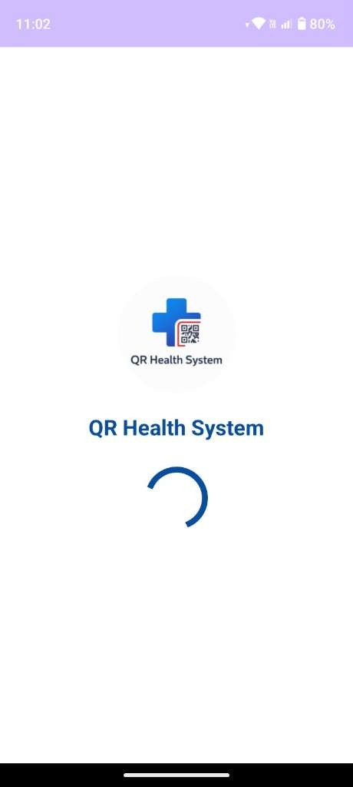

### Login and Registration
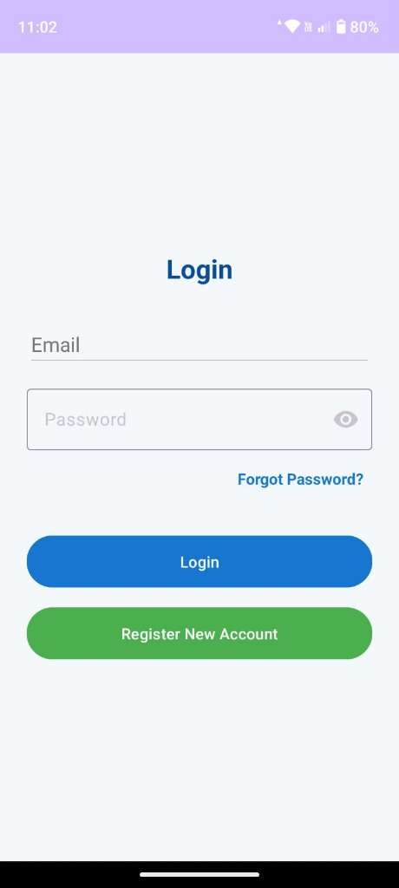
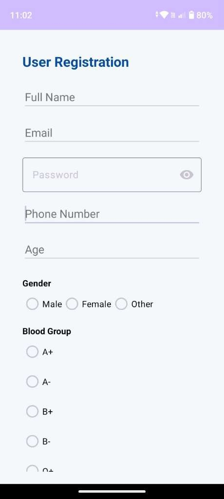
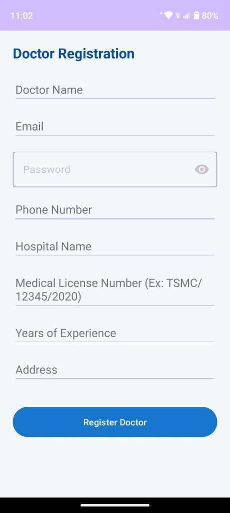
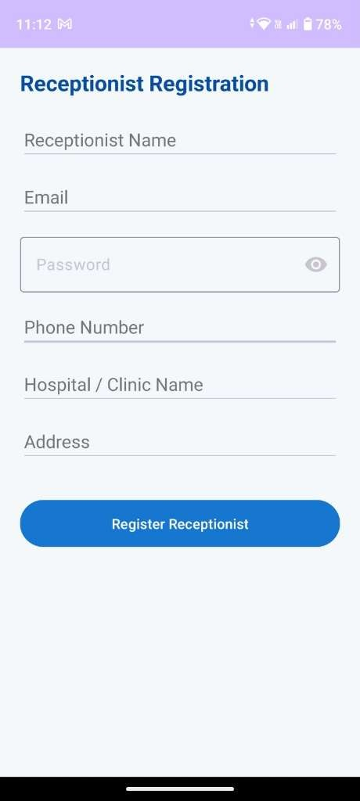

### Dashboards and QR Features
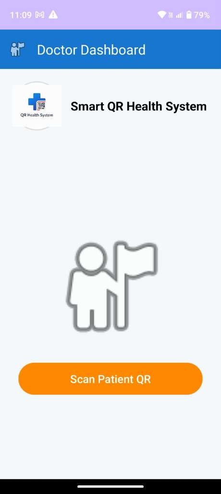
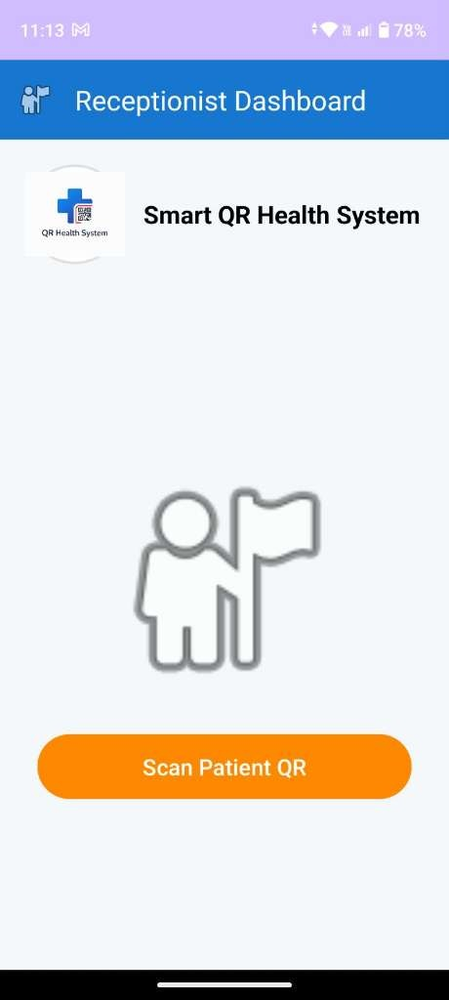
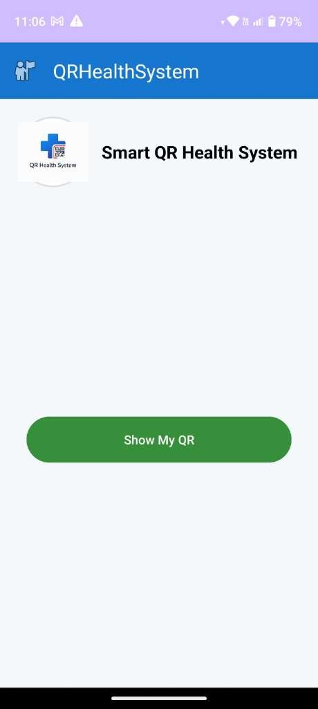
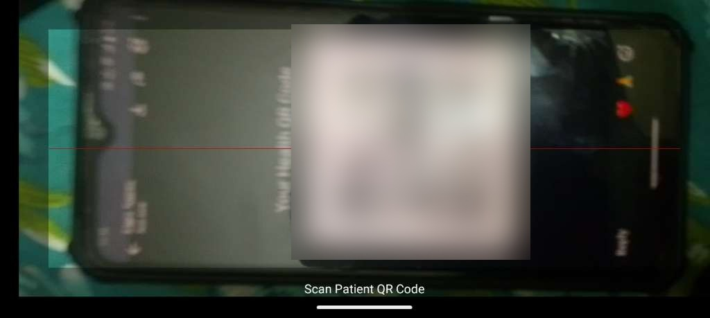
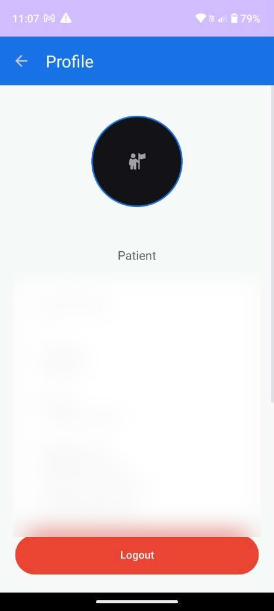
